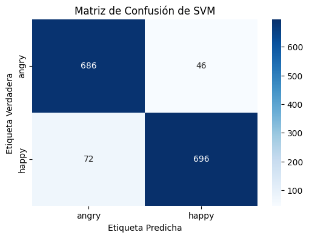

# Clasificación de expresiones faciales

Experimentos de visión por computador para distinguir las clases `angry` y `happy` mediante procesamiento de imágenes, descriptores visuales y modelos clásicos de aprendizaje automático.

El repositorio reúne tres cuadernos del mismo proyecto. Conserva tanto los primeros ensayos con estadísticas y filtros como una versión posterior que combina HOG, momentos de Hu, SVM, KNN y regresión logística. Los archivos se han renombrado para describir su contenido; **su código, metadatos y salidas permanecen idénticos a los originales**.

## Empezar por este cuaderno

[Abrir HOG y momentos de Hu en Google Colab](https://colab.research.google.com/github/own21m/clasificacion-expresiones-faciales/blob/main/notebooks/03-hog-hu-clasificadores.ipynb)

La versión `03` presenta el recorrido más claro: cargar imágenes, extraer características, entrenar tres clasificadores y comparar sus resultados. Necesita las carpetas de imágenes descritas más abajo; el conjunto completo de entrenamiento no está incluido.



## Cuadernos conservados

| Archivo                                                                                    | Qué contiene                                                                                                         | Nombre original                               |
| ------------------------------------------------------------------------------------------ | -------------------------------------------------------------------------------------------------------------------- | --------------------------------------------- |
| [01-estadisticas-filtros-svm-knn.ipynb](notebooks/01-estadisticas-filtros-svm-knn.ipynb)   | Normalización, filtro bilateral, Sobel, estadísticas de imagen y comparación SVM/KNN con distintos balances.         | `ProcesamientoDeImagenes.ipynb`               |
| [02-balanceo-augmentation-svm-knn.ipynb](notebooks/02-balanceo-augmentation-svm-knn.ipynb) | Ensayos con sobremuestreo, submuestreo, aumento de imágenes, ruido en características y búsqueda de hiperparámetros. | `sistema-reconocimiento-emociones-ia-1.ipynb` |
| [03-hog-hu-clasificadores.ipynb](notebooks/03-hog-hu-clasificadores.ipynb)                 | Características HOG y Hu, SVM lineal, KNN y regresión logística, evaluación y guardado de modelos.                   | `emotion-recognition.ipynb`                   |

Estas variantes comparten partes del código, pero no son duplicados completos. Permiten seguir la evolución desde ocho estadísticas por imagen hasta un vector de 1773 características. Los identificadores de Drive y hashes están en [docs/originales.json](docs/originales.json).

## Cómo funciona la versión principal

1. Lee imágenes en escala de grises desde las carpetas `angry` y `happy` de Google Drive.
2. Selecciona hasta 2500 imágenes de entrenamiento y 500 de prueba por clase y las redimensiona a 64 por 64 píxeles.
3. Aplica desenfoque gaussiano, detección de bordes Canny y normalización con OpenCV.
4. Construye un vector con HOG, media, varianza y los siete momentos de Hu. Con los parámetros guardados produce 1773 características por imagen.
5. Divide las características de entrenamiento en un 70 % para ajustar los modelos y un 30 % para validación interna, con `random_state=42`.
6. Compara un SVM lineal, KNN con cinco vecinos y regresión logística con `liblinear`.
7. Muestra exactitud, reporte de clasificación y matriz de confusión. También guarda los modelos con Joblib al ejecutar sus celdas.

La función de características calcula además curtosis y asimetría, pero esos dos valores no se concatenan en el vector final de la versión `03`.

## Resultados que ya estaban guardados

| Modelo de la versión 03 | Exactitud guardada | Evaluación                               |
| ----------------------- | ------------------ | ---------------------------------------- |
| SVM lineal              | 0.92               | 1500 imágenes de validación interna      |
| KNN, cinco vecinos      | 0.78               | La misma partición de validación interna |
| Regresión logística     | 0.92               | La misma partición de validación interna |

Son resultados de las salidas originales, **no un nuevo entrenamiento ni una evaluación independiente realizada durante esta organización**. Las tres cifras impresas tienen dos decimales.

El cuaderno también prepara 1000 imágenes de prueba y extrae sus características, pero las celdas de evaluación mostradas utilizan `X_val`, obtenido del conjunto de entrenamiento. Por tanto, el 0.92 no debe presentarse como exactitud sobre ese conjunto de prueba ni como desempeño garantizado sobre fotografías nuevas.

Los primeros cuadernos usan otras particiones, características y balances. Sus métricas sirven para estudiar esos experimentos y no son directamente comparables con las de la versión `03`.

## Datos necesarios

La versión principal espera esta organización en Google Drive:

```text
MyDrive/
  train-emotions/
    angry/
    happy/
  test-emotions/
    angry/
    happy/
```

La versión `01` utiliza las mismas carpetas dentro de `MyDrive/datasets/`. Las variables `train_dir` y `test_dir` indican las rutas en cada cuaderno.

La procedencia y licencia del conjunto no están identificadas en los archivos recibidos. El repositorio no añade el conjunto completo ni los modelos `.pkl` que se producen al entrenar. Conserva las salidas históricas, algunas de las cuales muestran pequeñas muestras de imágenes en la versión `02`.

Las etiquetas están codificadas como `angry=0` y `happy=1` en la versión principal. Describen las clases del experimento; el proyecto no constituye un diagnóstico del estado emocional de una persona.

## Ejecutar en Colab

1. Abre el cuaderno `03` con el enlace de arriba y guarda una copia de trabajo.
2. Prepara una **copia** del conjunto de imágenes y revisa las rutas `train_dir` y `test_dir`.
3. Revisa la celda de limpieza antes de ejecutarla: `remove_black_images` llama a `os.remove` y elimina imágenes uniformes del conjunto montado en Drive. El nombre habla de imágenes negras, pero su condición compara máximo y mínimo y alcanza cualquier imagen de un solo valor. Puedes omitir esa celda si no quieres modificar esos archivos.
4. Ejecuta las demás celdas en orden. La carga de Drive requiere autorización en tu propia sesión.
5. Los archivos `modelo_svm.pkl`, `modelo_knn.pkl` y `modelo_reg_log.pkl` se crean en el entorno de ejecución cuando se entrenan los modelos. Descárgalos antes de que termine la sesión si deseas conservarlos.

No se necesita una GPU para los algoritmos usados. La duración depende de la cantidad de imágenes y del equipo; no se ha medido un tiempo de entrenamiento en esta recuperación.

## Tecnologías y dependencias

| Tecnología            | Uso en el código                                                 |
| --------------------- | ---------------------------------------------------------------- |
| Python y Google Colab | Cuadernos y montaje de Google Drive.                             |
| NumPy y SciPy         | Vectores de características y estadísticas.                      |
| OpenCV                | Lectura, redimensionado, filtros, bordes y momentos de Hu.       |
| scikit-image          | Descriptor HOG.                                                  |
| scikit-learn          | SVM, KNN, regresión logística, particiones, balances y métricas. |
| Matplotlib y Seaborn  | Gráficas y matrices de confusión.                                |
| Pandas                | Importado en los experimentos originales.                        |
| Joblib                | Guardado de los modelos de la versión `03`.                      |

[requirements.txt](requirements.txt) enumera los paquetes importados; las versiones originales no estaban fijadas y no se presenta como un entorno bloqueado. `google.colab` pertenece al entorno de Colab. Ejecutar fuera de Colab requiere adaptar el montaje de Drive y las rutas en una copia de trabajo.

## Límites y diferencias entre variantes

- La primera línea de `01` contiene un carácter superíndice 8 (`U+2078`) antes de `import cv2`, que provoca un error de sintaxis. Se conserva en el original; para ejecutarlo habría que retirar ese carácter en una copia de trabajo.
- Las versiones `01` y `02` contienen bloques que ajustan `StandardScaler` con características de entrenamiento y prueba juntas. Esa mezcla introduce información del conjunto de prueba en el preprocesamiento y limita la interpretación de sus resultados.
- Algunos experimentos de `02` aumentan o balancean también el conjunto de prueba; no representan la evaluación de una distribución externa intacta.
- La carga usa los primeros elementos que devuelve `os.listdir`, sin lista de archivos guardada ni ordenación explícita. La selección de imágenes puede cambiar entre entornos.
- Las funciones de limpieza borran archivos del conjunto. Su presencia y ubicación se detallan en [docs/LIMITACIONES.md](docs/LIMITACIONES.md).
- No hay una aplicación de cámara en tiempo real, un servicio desplegado ni una red neuronal profunda en estos tres cuadernos.

## Conservación y validación

Los tres `.ipynb` se copiaron sin reserializar el JSON. Se compararon sus bytes con las descargas de origen y se validó la estructura básica de cuaderno. El análisis de sintaxis de las 31 celdas de código encontró el error de `U+2078` descrito en la versión `01`; las otras 30 celdas son sintácticamente válidas. No se ejecutaron celdas, no se montó Drive y no se cargaron archivos de modelos.

Los PNG de este README proceden de salidas que ya estaban guardadas; no se generaron nuevas métricas. Consulta [ORIGEN.md](docs/ORIGEN.md) para conocer los cambios de nombre y la procedencia.

No se añade una licencia nueva al código ni se atribuye una autoría exclusiva que no figure en los cuadernos. Los archivos originales siguen disponibles en sus enlaces de Colab.

La IA se utilizó como herramienta de aceleración de procesos para la organización y documentación del repositorio.
